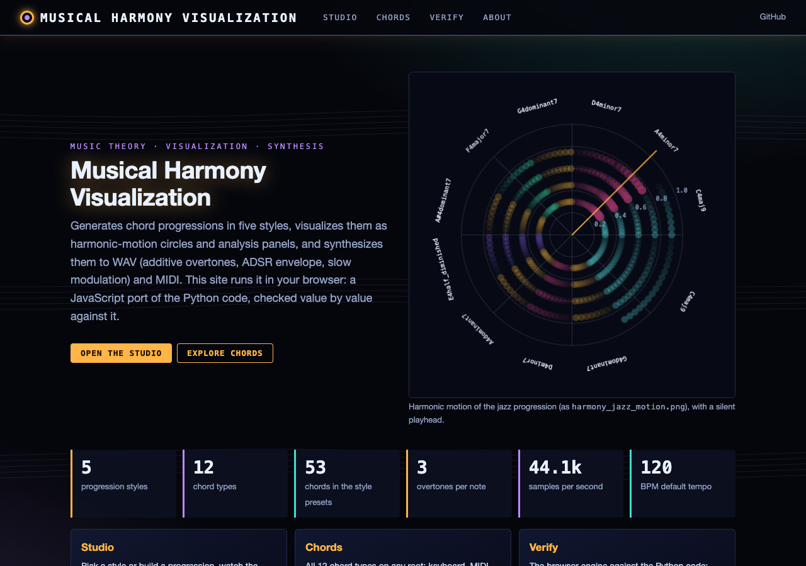
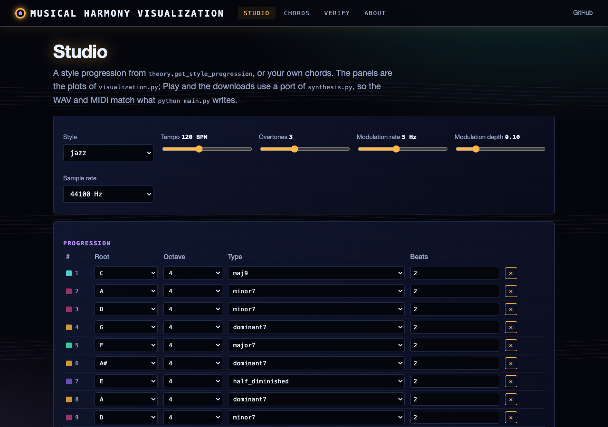
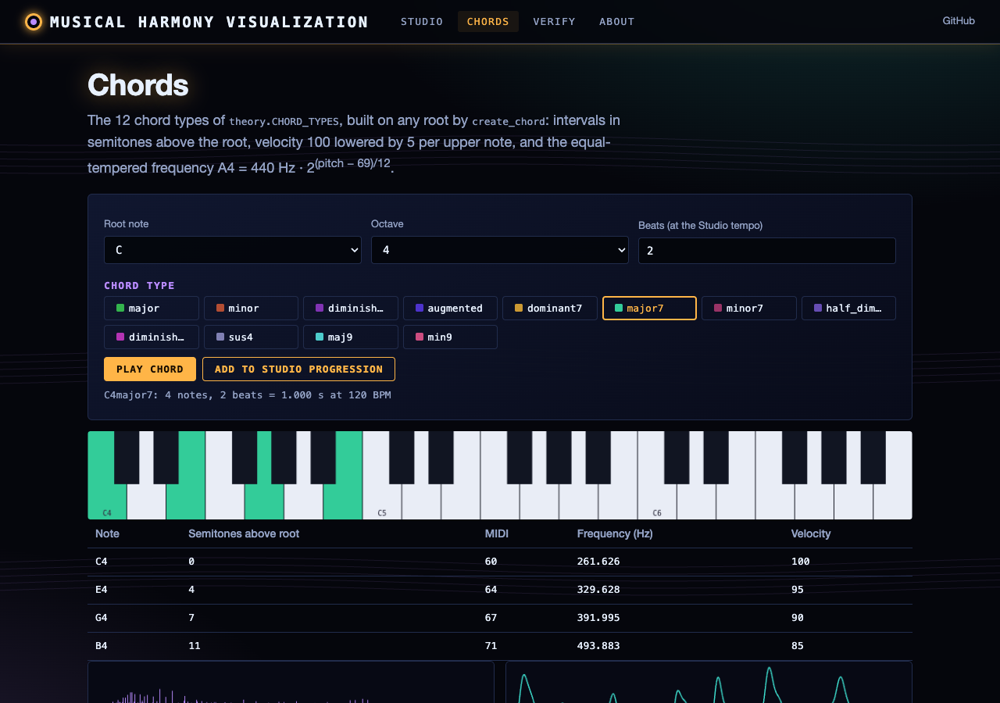
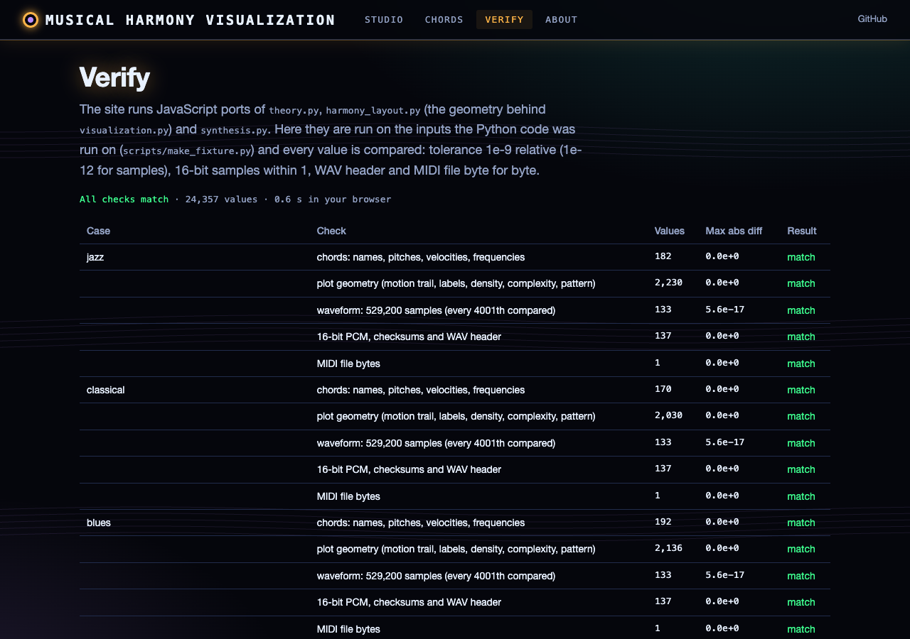

# Musical Harmony Visualization System

A sophisticated Python-based system that generates, visualizes, and synthesizes musical harmonies across different styles. This system combines music theory, audio synthesis, and creative visualization techniques to create a rich, multi-sensory representation of harmonic progressions.

## Features

### Musical Styles
- Jazz (extended harmonies and complex progressions)
- Impressionist (colorful and unconventional harmonies)
- Modal (sustained harmonies with modal characteristics)
- Classical (traditional harmonic progressions)
- Blues (12-bar dominant-seventh progression)

### Chord Types
- Major/Minor triads
- Dominant 7th chords
- Major/Minor 7th chords
- Extended chords (major 9th, minor 9th)
- Diminished, diminished 7th and half-diminished
- Suspended (sus4) chords
- Augmented chords

### Visualization Types
1. Motion Visualization
   - Circular representation with motion trails
   - Dynamic chord relationships
   - Color-coded harmony patterns

2. Advanced Analysis
   - Harmonic rhythm visualization
   - Note density plots
   - Complexity analysis
   - Style-specific patterns

### Audio Output
- MIDI file generation
- WAV file synthesis with:
  - Rich overtone structure
  - ADSR envelope shaping
  - Slow amplitude modulation (5 Hz tremolo)
  - Dynamic velocity control

## Installation

1. Clone this repository:
```bash
git clone https://github.com/gddickinson/musical-harmony-visualization.git
cd musical-harmony-visualization
```

2. Install required dependencies:
```bash
pip install -r requirements.txt
```

## Usage

### Command line

```bash
python main.py                      # all five styles into the current directory
python main.py --style jazz --tempo 100 --output-dir out
```

### Basic Usage

Generate a single style progression:

```python
from theory import ProgressionStyle, create_chord, get_style_progression
from synthesis import SynthConfig, create_audio_files
from visualization import create_rich_visualization

style = ProgressionStyle.JAZZ
chords = [create_chord(root, chord_type, duration)
          for root, chord_type, duration in get_style_progression(style)]
create_audio_files(chords, f"harmony_{style.value}", SynthConfig(tempo_bpm=120))
create_rich_visualization(chords, f"harmony_{style.value}", style)
```

### Generate All Styles

```python
for style in ProgressionStyle:
    chords = [create_chord(root, chord_type, duration)
              for root, chord_type, duration in get_style_progression(style)]
    create_audio_files(chords, f"harmony_{style.value}")
    create_rich_visualization(chords, f"harmony_{style.value}", style)
```

## Output Files

For each generated progression, the system creates:

1. `harmony_[style].mid`
   - MIDI file for playback in any DAW or media player
   - Contains full chord progression with velocity information

2. `harmony_[style].wav`
   - Synthesized audio file
   - Rich harmonic content with overtones
   - Professional-quality ADSR envelope shaping

3. `harmony_[style]_motion.png`
   - Circular visualization of harmonic motion
   - Shows chord relationships and transitions
   - Includes motion trails for progression analysis

4. `harmony_[style]_advanced_analysis.png`
   - Multi-panel analysis visualization
   - Harmonic rhythm display
   - Note density analysis
   - Style-specific pattern analysis

## Web interface

**Live site: https://gddickinson.github.io/musical-harmony-visualization/** (static, runs entirely in your browser).

The static site is the working program: JavaScript ports of `theory.py`, `harmony_layout.py` (the geometry behind
`visualization.py`) and `synthesis.py`, checked against the Python output. Pick a style or build your own progression,
watch the harmonic-motion circle and the analysis panels redraw, play it (WebAudio, only after you press Play) and
download the same WAV and MIDI files `python main.py` writes (byte-identical for the presets).

| Page | What it does |
|------|--------------|
| Studio | Style presets or a custom progression; tempo, overtones, modulation, sample rate; motion circle, pattern, progression, density and complexity panels; Play, WAV, MIDI; with the local server, the real matplotlib PNGs |
| Chords | All 12 chord types on any root: keyboard, MIDI pitches, frequencies, velocities, waveform, play |
| Verify | The JS engine against `tests/fixtures/harmony_reference.json` (chords, plot geometry, samples, WAV header, MIDI bytes); locally, your own progression against Python |






### Run the web app

```bash
pip install -r requirements-web.txt
python run_web.py                     # http://127.0.0.1:8165
python -m pytest -q tests/ test_theory.py
python scripts/build_static.py        # static site in site/ (published by .github/workflows/pages.yml)
python scripts/make_fixture.py        # regenerate the Python reference after changing theory/synthesis/layout
```

## Customization

### Creating Custom Progressions

```python
# Define custom progression: (root, chord_type, duration in beats)
custom_progression = [
    ('C4', 'major7', 2.0),
    ('A4', 'minor7', 2.0),
    ('D4', 'dominant7', 2.0),
    ('G4', 'major7', 2.0),
]

chords = [create_chord(root, chord_type, duration)
          for root, chord_type, duration in custom_progression]
create_audio_files(chords, "custom_progression")
create_rich_visualization(chords, "custom_progression")
```

Chord types are the keys of `theory.CHORD_TYPES`; roots are note names with a
single-digit octave (`C4`, `F#3`, sharps only).

### Modifying Synthesis Parameters

`synthesis.SynthConfig` holds the sample rate, tempo, number of overtones and the
modulation frequency and depth. The ADSR envelope ratios are module constants in
`synthesis.py` (`ATTACK_RATIO`, `DECAY_RATIO`, `SUSTAIN_LEVEL`, `RELEASE_RATIO`).

## Musical Theory

### Chord Construction
- Triads: Root, Third, Fifth
- Seventh Chords: Root, Third, Fifth, Seventh
- Extended Chords: Additional ninths, elevenths, thirteenths
- Altered Chords: Modified fifths or ninths

### Style Characteristics
- Jazz: Complex harmonies, extended chords, ii-V-I progressions
- Impressionist: Colorful harmonies, non-traditional progressions
- Modal: Sustained harmonies, modal interchange
- Classical: Traditional harmony, functional progressions

## Technical Details

### Audio Synthesis
- Sample rate: 44100 Hz
- Bit depth: 16-bit
- Synthesis method: additive (fundamental + 3 overtones) with 5 Hz amplitude modulation
- Envelope: ADSR, proportional to each chord's length
- Timing: chord durations are beats, converted with the tempo (default 120 BPM) for both MIDI and WAV

### Visualization
- High-resolution output (300 DPI)
- Multiple visualization layers
- One colour per chord type (`theory.CHORD_TYPES`)

## Contributing

Areas for potential enhancement:
- Additional musical styles
- More visualization types
- Enhanced synthesis methods
- Real-time MIDI input
- Additional analysis tools
- GUI interface

## License

This project is licensed under the MIT License - see the LICENSE file for details.

## Acknowledgments

- Built using numpy and matplotlib
- Music theory principles from various traditions
- Synthesis techniques inspired by classic synthesizers
- Visualization concepts from music theory analysis


---
*Built with AI assistance from [Claude (Anthropic)](https://claude.com/).*
